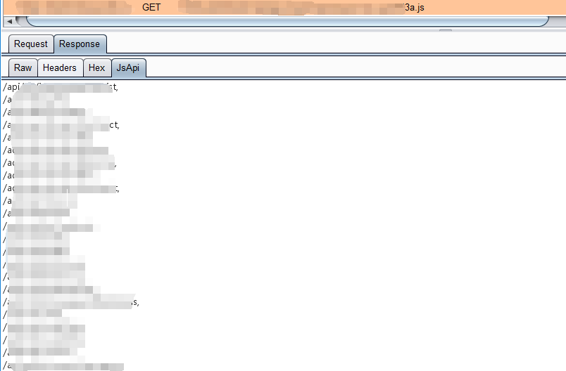
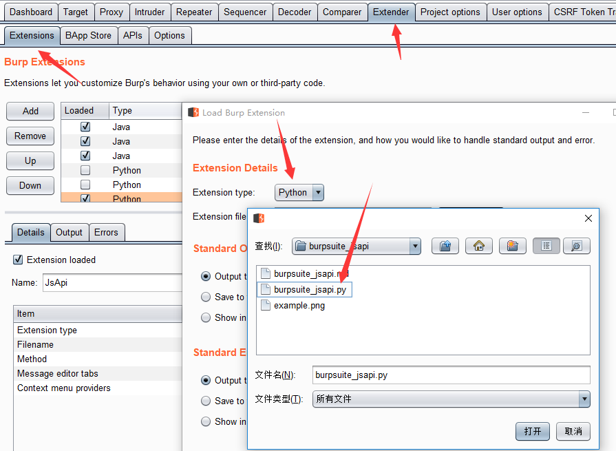

# burpsuite_jsapi

[简体中文](README_zh-CN.md)

`burpsuite_jsapi` is a lightweight Burp Suite extension for finding API endpoints referenced in JavaScript files. It adds a `JsApi` message editor tab and lists matched paths or URLs from the current HTTP message body.



## Features

- Extracts API-like paths from JavaScript responses, for example `/api/user/list`.
- Extracts absolute and protocol-relative URLs, for example `https://example.com/api` and `//example.com/api`.
- Preserves the original discovery order while removing duplicates.
- Shows results in a read-only `JsApi` tab to avoid accidentally rewriting HTTP messages.
- Provides a context-menu switch for active detection. When enabled, `JsApi` can display matches from non-JavaScript messages too.

## Requirements

- Burp Suite with Python extension support.
- Jython 2.7 configured in Burp Suite.

In Burp Suite, configure Jython from `Extender` -> `Options` -> `Python Environment` before loading this extension.

## Installation

```bash
git clone https://github.com/0xzmz/burpsuite_jsapi.git
```

Then load the extension in Burp Suite:

1. Open `Extender` -> `Extensions`.
2. Click `Add`.
3. Set `Extension type` to `Python`.
4. Select `burpsuite_jsapi.py`.
5. Confirm that Burp reports the extension as loaded.



## Usage

1. Browse or send traffic through Burp Suite.
2. Open a request or response that contains JavaScript.
3. Click the `JsApi` tab in the message editor.
4. Review the extracted endpoints.

By default, the tab is shown only when the message body contains matches and the message has a JavaScript `Content-Type`, such as `application/javascript` or `text/javascript`.

To inspect other response types, right-click in Burp and choose `Turn JsApi active detection on`. Use the same menu item again to turn it off.

## Matching Scope

The extension currently focuses on quoted JavaScript string values that start with:

- `/`, such as `/api/v1/users`
- `http://` or `https://`
- `//`, such as `//example.com/api`

It is designed for quick discovery during testing, not for complete JavaScript parsing. Minified code, dynamically assembled URLs, encrypted bundles, or endpoints split across multiple variables may require manual review.

## Development

This project targets Jython 2.7, so avoid Python 3-only syntax such as f-strings, annotations, and keyword-only arguments.

The main extension entry point is [`burpsuite_jsapi.py`](burpsuite_jsapi.py). Burp loads the `BurpExtender` class and registers:

- a custom message editor tab named `JsApi`
- a context menu item that toggles broader endpoint detection

## Contributing

Issues and pull requests are welcome. Useful improvements include broader endpoint matching, tests for extraction rules, and better handling for source maps or bundled JavaScript.
