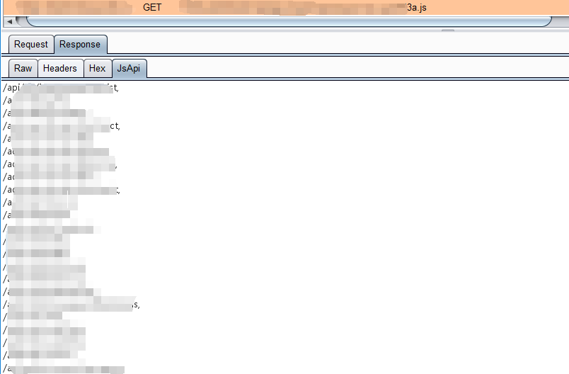
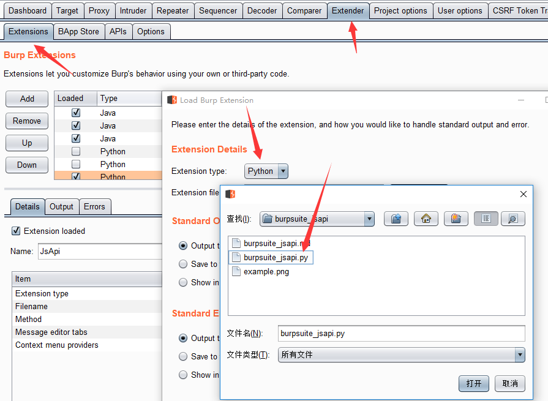

# burpsuite_jsapi

[English](README.md)

`burpsuite_jsapi` 是一个轻量级 Burp Suite 扩展，用于从 JavaScript 文件中快速提取 API 接口。插件会在 HTTP 消息编辑器中增加 `JsApi` 标签页，并展示当前消息正文里匹配到的路径或 URL。



## 功能特性

- 提取 JavaScript 响应中的接口路径，例如 `/api/user/list`。
- 提取绝对 URL 和协议相对 URL，例如 `https://example.com/api`、`//example.com/api`。
- 按发现顺序输出结果，并自动去重。
- 结果面板只读，避免误把接口列表写回 HTTP 请求或响应。
- 提供右键菜单开关。开启主动检测后，插件也可以在非 JavaScript 消息中展示匹配结果。

## 环境要求

- 支持 Python 扩展的 Burp Suite。
- 已在 Burp Suite 中配置 Jython 2.7。

加载插件前，请先在 Burp Suite 的 `Extender` -> `Options` -> `Python Environment` 中配置 Jython。

## 安装方式

```bash
git clone https://github.com/0xzmz/burpsuite_jsapi.git
```

然后在 Burp Suite 中加载插件：

1. 打开 `Extender` -> `Extensions`。
2. 点击 `Add`。
3. 将 `Extension type` 设置为 `Python`。
4. 选择 `burpsuite_jsapi.py`。
5. 确认 Burp 显示插件已成功加载。



## 使用方式

1. 让浏览器或工具流量经过 Burp Suite。
2. 打开包含 JavaScript 的请求或响应。
3. 点击消息编辑器中的 `JsApi` 标签页。
4. 查看提取出的接口列表。

默认情况下，只有消息正文中存在匹配结果，并且 `Content-Type` 是 JavaScript 类型时，才会显示 `JsApi` 标签页，例如 `application/javascript` 或 `text/javascript`。

如果需要检查其他类型的消息，可以在 Burp 中右键选择 `Turn JsApi active detection on`。再次点击该菜单项即可关闭。

## 匹配范围

当前插件主要匹配 JavaScript 字符串中以下形式的内容：

- 以 `/` 开头的路径，例如 `/api/v1/users`
- 以 `http://` 或 `https://` 开头的完整 URL
- 以 `//` 开头的协议相对 URL，例如 `//example.com/api`

插件定位是辅助测试时快速发现接口，并不是完整的 JavaScript 解析器。对于压缩混淆代码、运行时动态拼接 URL、加密后的资源包，或被拆分在多个变量中的接口，仍然需要人工复核。

## 开发说明

本项目面向 Jython 2.7，因此请避免使用 f-string、类型注解、keyword-only arguments 等 Python 3 专属语法。

主要入口文件是 [`burpsuite_jsapi.py`](burpsuite_jsapi.py)。Burp 会加载其中的 `BurpExtender` 类，并注册：

- 名为 `JsApi` 的自定义消息编辑器标签页
- 用于切换扩大检测范围的右键菜单项

## 参与贡献

欢迎提交 issue 和 pull request。适合继续完善的方向包括：扩展接口匹配规则、为提取逻辑补充测试、增强 sourcemap 或打包后 JavaScript 的处理能力。
